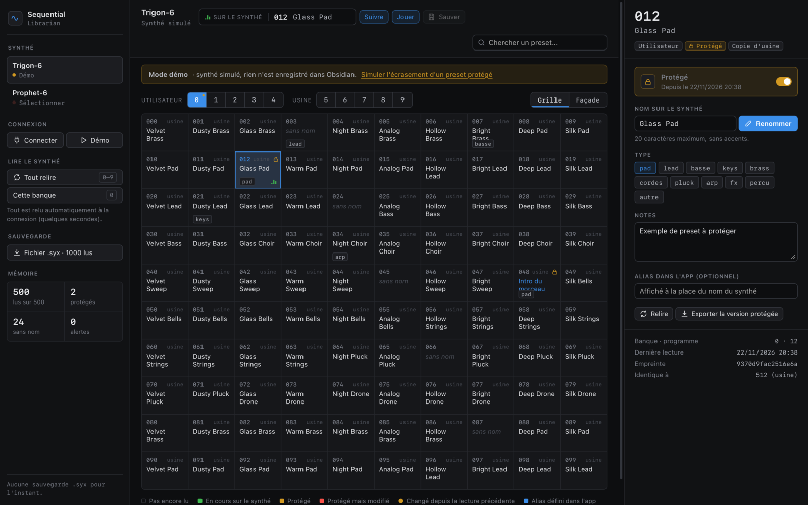
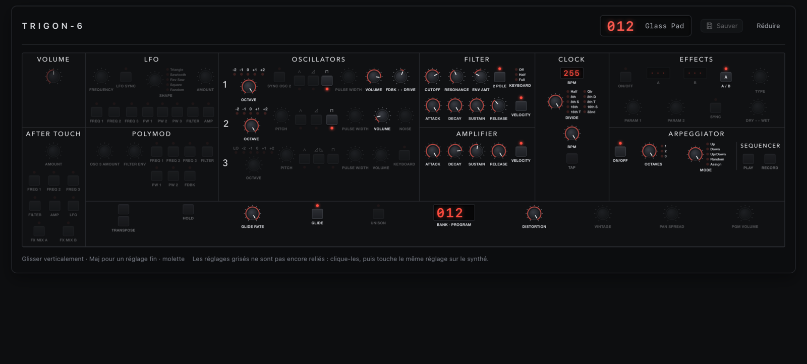

# Sequential Librarian

Gestionnaire de presets pour les synthés **Sequential Trigon-6** et **Prophet-6**, pour macOS.

Ces synthés ne permettent pas de nommer ni de ranger facilement leurs 1000 programmes depuis la machine. Sequential Librarian lit toute la mémoire du synthé en USB (SysEx) et permet de :

- voir les 1000 presets d'un coup d'œil, avec leur nom et un type (pad, lead, basse…) ;
- charger un preset sur le synthé d'un clic ;
- **protéger** les presets importants : alerte s'ils sont écrasés, export de la version protégée en `.syx` ;
- **renommer** un preset directement sur le synthé (Trigon-6) ;
- **sauver** le son en cours, avec ses réglages modifiés, dans l'emplacement de son choix (copie `.syx` de l'ancien contenu avant chaque écriture, puis relecture pour vérifier) ;
- **réorganiser** les banques par glisser-déposer : échanger deux presets, ou en insérer un en décalant les autres ;
- afficher la **façade** du synthé avec les potards du son en cours, synchronisée dans les deux sens ;
- garder une base et une note Markdown (pratique avec Obsidian) dans le dossier de son choix.





_Captures en mode démo (synthé simulé)._

### La façade

Elle reprend la disposition du synthé. Un réglage allumé suit le son en cours ; s'il est pilotable, on le tourne à la souris (glisser verticalement, Maj pour un réglage fin, molette) et le synthé suit.

- **Trigon-6** : 30 réglages sont reliés d'avance, vérifiés sur la machine (le Trigon-6 ne reçoit qu'une partie de ses réglages en CC). Les autres sont grisés : clique un réglage grisé, puis touche le même sur le synthé, et l'app repère où il est rangé. Il s'affiche alors, et devient pilotable s'il existe un CC pour lui. ⌥ clic pour oublier un lien.
- **Prophet-6** : les réglages viennent du manuel (NRPN et CC). Au premier affichage, le bouton « Vérifier sur le synthé » les teste un par un sur la machine (valeur de test, relecture, puis retour au son d'origine) et n'affiche que ceux qui sont confirmés.

Un device **Max for Live** affiche aussi le preset en cours dans Ableton Live, et ouvre l'application.

> Projet personnel, non affilié à Sequential. À utiliser à vos risques : faites une sauvegarde `.syx` de votre synthé avant toute écriture.

## Installation

Il faut macOS 12 ou plus récent et les outils de développement d'Apple (Xcode ou les Command Line Tools), ainsi que Python 3 et Node.js pour les scripts et les tests.

1. Copier `config.example.json` en `config.json` et l'adapter (ce fichier reste local, il n'est pas versionné) :

   | Clé | Rôle | Par défaut |
   | :- | :- | :- |
   | `dataDir` | Dossier de la base, des notes Markdown et des sauvegardes `.syx` (par exemple un dossier d'un vault Obsidian) | `~/Documents/Sequential Librarian` |
   | `installDir` | Où installer l'application | `/Applications` |
   | `maxForLiveDir` | Où installer le device Max for Live | `~/Music/Max for Live` |

2. Construire et installer :

   ```bash
   make app
   make device
   ```

3. Sur le synthé : **GLOBALS**, réglage **MIDI SysEx = USB**. Pour la façade du Trigon-6 : **Param Rcv = CC**.

## Développement

| Commande | Rôle |
| :- | :- |
| `make test` | Tests (format SysEx, façade, configuration, serveur) |
| `make check` | Vérification de la syntaxe JavaScript, Python et Swift |
| `make serve` | Ouvre l'interface dans Chrome, avec ses outils de développement |
| `make clean` | Supprime `build/` |

L'application relit `web/` à chaque ouverture : modifier l'interface ne demande pas de reconstruire. Reconstruire (`make app`) après une modification de `macos/` ou de l'icône.

L'application a un mode de test qui exécute un script dans la page puis quitte, ce qui permet de tester sur un vrai synthé sans toucher au dossier de données réel :

```bash
SP_DATA_DIR=/tmp/essai "/Applications/Sequential Librarian.app/Contents/MacOS/SequentialLibrarian" \
  --test mon-test.js resultat.txt
```

## Organisation

| Dossier | Contenu |
| :- | :- |
| `web/` | Interface : `index.html`, `css/`, et `js/` découpé par rôle (`sysex.js` format SysEx, `midi.js` échanges, `live.js` son en cours, `actions.js` écriture, `reorder.js` réorganisation, `panel-layouts.js` dessin des façades, `panel.js` façade, `panel-check.js` vérification des réglages, `render.js` affichage…) |
| `macos/` | Application Mac (Swift) : fenêtre, pont MIDI CoreMIDI vers l'interface, accès aux fichiers |
| `m4l/` | Device Max for Live : logique (`device.js`) et bouton d'ouverture de l'app (`launch.js`) |
| `scripts/` | Construction (`build_app.py`, `build_device.py`) et lecture de la configuration (`config.py`) |
| `tools/` | Serveur de développement pour Chrome |
| `tests/` | Tests automatiques |
| `docs/screenshots/` | Captures d'écran du README |
| `assets/icon/` | Icône : `icon.svg` (source) et `icon-1024.png` (export) |

## Notes techniques

- Identification par Device Inquiry : Trigon-6 = `0x39`, Prophet-6 = `0x2D`.
- Programme : `F0 01 id 05 banque prog F7` ; réponse de 1171 octets compressés (1024 décompressés).
- Son en cours : `F0 01 id 06 F7` ; écriture d'un programme : `F0 01 id 02 banque prog [données] F7`.
- Nom du programme (Trigon-6) : 20 caractères ASCII à la position 116 des données décompressées.
- La façade n'affiche que les réglages dont la position dans les données a été vérifiée sur un Trigon-6 réel, en envoyant chaque CC et en relisant le son en cours. La position du nom sur le Prophet-6 n'est pas encore vérifiée : le renommage y est désactivé.
